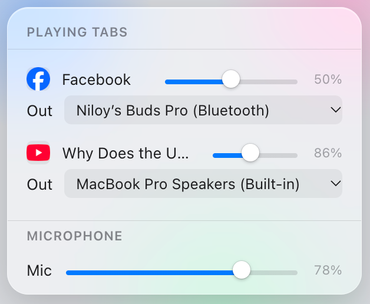

  

<h1 align="center">Tab Audio Control</h1>

  A Chrome extension (Manifest V3) for setting volume and output device per tab, plus one gain control for your microphone.

  

## What it does

- **Per-tab volume.** Each tab that's playing sound appears in the popup with its own slider (0 to 100%). If the site has its own volume control, like YouTube's, the two stay in sync.
- **Per-tab output device.** You can send one tab to your headphones and another to the laptop speakers. In Chrome the device list only appears on sites that already have microphone permission, which call sites like Messenger or Meet usually do.
- **Route a tab (optional).** On sites without mic permission, like YouTube, "Route this tab" captures the tab's audio and plays it through the extension instead. A routed tab can go to any output device and up to 200% volume, and it also covers audio the page plays through Web Audio. Routing is off until you turn it on for a tab.
- **Mic gain.** One slider turns your microphone up or down on every site. It applies to mic streams that start after the extension loads.

Settings last for the browser session only. They survive Chrome putting the extension to sleep, but closing a tab, restarting the browser, or reloading the extension resets everything to 100% volume and the system default output, and ends any routing.

## Install

No build step and no dependencies.

1. Open `chrome://extensions` and turn on **Developer mode**.
2. Click **Load unpacked** and select this folder.
3. Pin the extension and click its icon while a tab is playing audio.

Tabs that were already open get the extension's scripts added automatically when it installs or reloads, so you don't need to refresh a call that's in progress.

## Using it

- Tabs show up in the popup while they're audible, and stay listed once you've changed their volume or output, or routed them.
- The **Out** row under each tab shows what you can do on that site:
  - A device dropdown: pick an output.
  - "Route this tab": Chrome only lists output devices to sites with mic permission, so on other sites the extension can capture the tab and play it back itself. Open the popup on that tab and click the button. The first time, a setup page asks for microphone permission for the extension, which Chrome needs before it will show device names. Grant it, go back to the tab, and click the button again. Clicking the button on a tab that isn't the one you opened the popup over switches to that tab; open the popup again there to route it.
  - A routed tab's dropdown lists the extension's devices, with "Stop routing" at the bottom to hand the tab back to normal control at its previous volume (capped at 100%).
  - "Refresh this tab to enable controls": the extension can't reach that tab. This happens on `chrome://` pages and the Web Store, where extensions aren't allowed to run.
  - "Grant on page…": only appears in browsers that support `selectAudioOutput()` (Firefox, currently). Clicking it shows a button on the page itself, which you then click to open the browser's device picker.

## Limitations

- On tabs that aren't routed, volume and output only reach `<audio>` and `<video>` elements in the page, including ones inside open shadow roots. Audio played through the Web Audio API, or through an audio element that's never added to the page, won't respond. Routing the tab covers those.
- Volume can't go above 100% unless the tab is routed. The browser caps `HTMLMediaElement.volume` at 1.
- A routed tab shows Chrome's capture indicator while it's routed.
- A routed tab can't go truly fullscreen: Chrome keeps its fullscreen video inside the browser window, with the toolbar still showing. Stop routing before watching fullscreen.
- You can only route the tab the popup was opened over. Chrome requires that each time a capture starts, so after a browser restart or extension reload you have to route the tab again.
- While a tab is routed, the site's own volume control still works and combines with the popup slider (50% on the site and 50% in the popup plays at 25%).
- Mic gain doesn't affect a mic stream that started before the extension loaded. Rejoin the call to pick it up.

## Files

| File | Role |
|---|---|
| `manifest.json` | Permissions and content script registration |
| `background.js` | Service worker. Holds per-tab state and relays messages between the popup and tabs |
| `content.js` | Runs in every frame. Finds media elements and applies volume and output device |
| `mic-gain-hook.js` | Runs in the page's own JS world. Wraps `getUserMedia` with a gain node |
| `offscreen.html` / `offscreen.js` | Hidden extension page that plays routed tabs' captured audio, with a gain node and output device per tab |
| `setup.html` / `setup.js` | One-time page that asks for microphone permission for the extension, so it can list output device names. Stops the mic straight away |
| `popup.html` / `popup.js` / `popup.css` | The popup UI. `setup.html` reuses `popup.css` |
| `icons/` | Extension icon. `icon.svg` is the source for 32/48/128, and `icon-16.svg` is a simpler version for the toolbar |
| `tests/` | Mock tests for the scripts, run with Node and no dependencies (see AGENTS.md) |
| `docs/` | Images used by this README |
| `PRIVACY.md` | Privacy policy, used as the Chrome Web Store privacy policy URL |
| `NEXT_BUILD.md` | Design notes for planned features |
